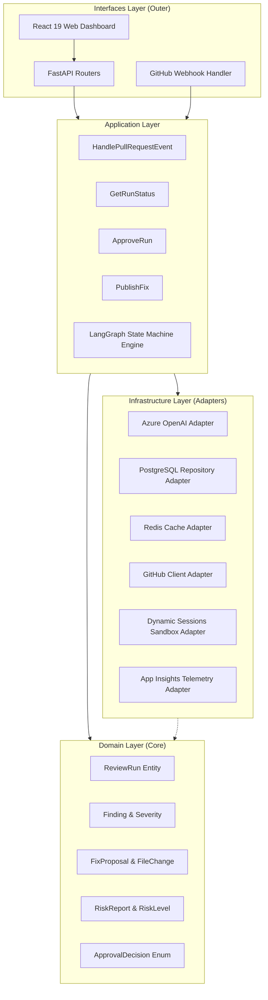
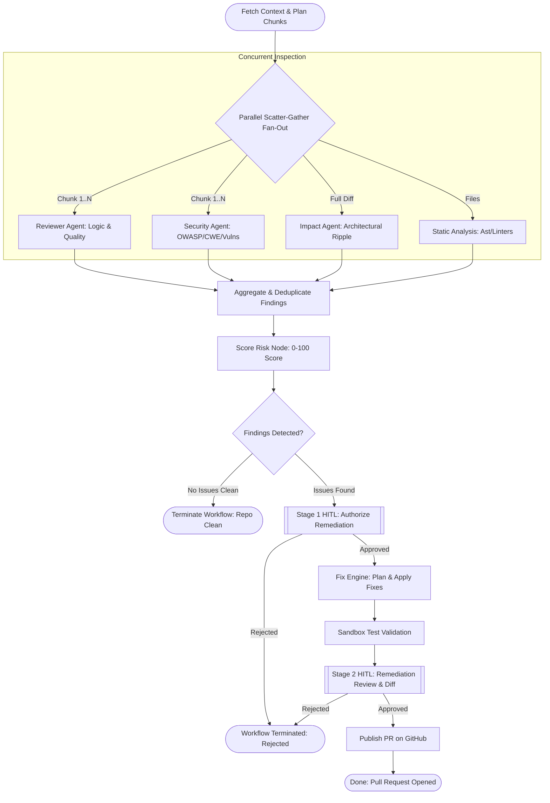

# 📘 PR-Review-Assistant: Deep Architecture & Technical Guide

Welcome to the definitive guide for **PR-Review-Assistant** — an enterprise-grade, autonomous, multi-agent code analysis and automated remediation platform with dual Human-in-the-Loop (HITL) safeguards.

---

## 📑 Table of Contents
1. [Executive Overview](#1-executive-overview)
2. [Technologies & Tools Stack](#2-technologies--tools-stack)
3. [System Architecture (Clean Architecture / Hexagonal)](#3-system-architecture)
4. [Multi-Agent Design Patterns](#4-multi-agent-design-patterns)
5. [End-to-End Workflow & Two-Stage HITL Gates](#5-end-to-end-workflow--two-stage-hitl-gates)
6. [How to Use the Platform (User & Developer Guide)](#6-how-to-use-the-platform)
7. [Enterprise Best Practices, Security & Observability](#7-enterprise-best-practices-security--observability)

---

## 1. Executive Overview

**PR-Review-Assistant** is designed to transform pull request reviews and static repository analysis from a manual, error-prone chore into an intelligent, highly parallelized, and secure agentic workflow.

### Core Objectives:
- **Comprehensive Multi-Vector Analysis:** Inspect codebases for bugs, logical flaws, security vulnerabilities (OWASP/CWE), performance bottlenecks, dependency risks, and anti-patterns.
- **Strict Human-in-the-Loop (HITL) Guardrails:** No AI agent is permitted to write or modify code without explicit human review and authorization at two strategic gates.
- **Automated Sandbox Verification:** Proposed fixes are validated in isolated microVM sandboxes before human review.
- **Zero-Touch Pull Request Publication:** Approved patches are automatically pushed to dedicated branches and opened as pull requests on GitHub.

---

## 2. Technologies & Tools Stack

The platform is structured as a decoupled full-stack application running on Microsoft Azure cloud infrastructure.

```
┌────────────────────────────────────────────────────────────────────────┐
│                        PR-Review-Assistant Stack                       │
├────────────────────────────────┬───────────────────────────────────────┤
│ Frontend: React 19 + Vite      │ Backend: FastAPI + LangGraph          │
├────────────────────────────────┼───────────────────────────────────────┤
│ AI: Azure OpenAI (GPT-4.1)     │ Database: Azure PostgreSQL Flexible   │
├────────────────────────────────┼───────────────────────────────────────┤
│ Cache: Azure Cache for Redis   │ Sandbox: Azure Container Apps Sessions│
├────────────────────────────────┼───────────────────────────────────────┤
│ Telemetry: App Insights + OTel │ CI/CD: GitHub Actions                 │
└────────────────────────────────┴───────────────────────────────────────┘
```

### Detailed Breakdown of Components:

| Component / Tool | Technology / Version | Role & Specific Purpose in Project |
| :--- | :--- | :--- |
| **Backend Framework** | **Python 3.12+ / FastAPI** | High-performance asynchronous REST API handling webhook ingestion, repository monitoring, agent trigger orchestration, and dashboard queries. |
| **Agentic Workflow Engine** | **LangGraph / LangChain** | Deterministic state machine governing the multi-agent execution graph, parallel node fan-out/fan-in, conditional routing, and checkpointed interrupt pauses (`interrupt()`). |
| **Language Models** | **Azure OpenAI Service** | Provides structured reasoning via Pydantic models. Routed dynamically between: <br>• **Strong Tier (`gpt-4.1`):** Deep code reasoning, semantic security auditing, fix plan generation, patch formulation. <br>• **Fast Tier (`gpt-4.1-mini`):** High-throughput triage, risk scoring, change summarization. |
| **Database & Persistence** | **Azure Database for PostgreSQL (Flexible Server)** | Stores historical audit runs, structured findings, fix proposals, diffs, and execution traces. Powers the LangGraph `PostgresSaver` checkpointer for state preservation across worker restarts. |
| **Distributed Cache** | **Azure Cache for Redis** | High-speed cache for webhook deduplication (`set_if_absent`), rate-limiting, and fast entity lookups. |
| **Execution Sandbox** | **Azure Container Apps Dynamic Sessions** | Secure, ephemeral microVM execution sandboxes. Runs automated tests, linters, and compilers to verify agent-generated code without host risk. |
| **Observability & Tracing** | **Azure Application Insights & OpenTelemetry** | Distributed tracing across agent nodes, custom span recording, exception tracking, and real-time LLM token usage metrics. |
| **VCS Integration** | **GitHub REST API & Webhooks** | Signature-verified webhook receiver (HMAC-SHA256), tree inspection, commit authoring via Git Tree API, and Pull Request publication. |
| **Frontend Framework** | **React 19 / TypeScript** | Modern reactive dashboard delivering real-time status updates, interactive node pipelines, risk gauges, and side-by-side diff viewers. |
| **Client Build System** | **Vite** | Fast Hot-Module-Replacement (HMR) development and optimized production bundling. |
| **Client State Management** | **TanStack React Query v5** | Declarative data fetching, caching, automatic polling, and optimistic mutations for approvals. |
| **Code Diff Viewer** | **Custom Diff Component** | Unified and split-view visual rendering of original versus remediated code changes with line-by-line syntax highlighting. |
| **Code Quality & CI/CD** | **Ruff, Bandit, Pytest, ESLint** | Complete CI verification suite running on GitHub Actions for Python code formatting, security linting, unit/integration testing, and TypeScript checking. |

---

## 3. System Architecture

The backend strictly adheres to **Clean Architecture (Hexagonal / Ports & Adapters)** principles to maintain separation of concerns, testability, and framework independence.



### Layer Responsibilities:

1. **Domain Layer (`app/domain`):**
   - Pure Python dataclasses and enums with **zero external dependencies**.
   - Defines `ReviewRun`, `Finding`, `FixProposal`, `FileChange`, `RiskReport`.
   - Encapsulates domain invariants (e.g., a fix proposal is only `publishable` if it is verified AND contains actual changes).

2. **Application Layer (`app/application`):**
   - Contains business use cases: `HandlePullRequestEvent`, `GetRunStatus`, `ApproveRun`, `PublishFix`.
   - Defines abstract **ports** (interfaces) for external capabilities: `LLMPort`, `GitHubPort`, `CachePort`, `SandboxPort`, `ReviewRunRepository`.
   - Houses the **LangGraph Agent Workflow** nodes and graph topology.

3. **Infrastructure Layer (`app/infrastructure`):**
   - Implements the ports with concrete external technologies.
   - Contains `AzureOpenAILLM`, `PostgreSqlReviewRunRepository`, `RedisCache`, `GitHubClient`, `DynamicSessionsSandbox`, and `TelemetryManager`.

4. **Interfaces Layer (`app/interfaces`):**
   - HTTP entry points: `/api/runs`, `/api/repos`, `/api/approvals`, `/api/webhooks`, `/api/health`.
   - Fast dependency injection providers using FastAPI's `Depends`.

---

## 4. Multi-Agent Design Patterns

The system avoids naive linear prompting by employing battle-tested **Multi-Agent Orchestration Patterns**:



### Key Multi-Agent Patterns Implemented:

### 1. Scatter-Gather (Parallel Fan-Out / Fan-In)
- When a codebase or PR is fetched, `PlanAnalysisNode` intelligently breaks files into logical chunks based on token limits and file boundaries.
- Using LangGraph's `Send` primitives, chunks are analyzed in parallel across multiple worker threads:
  - **`ReviewerAgent`:** Detects bugs, edge cases, error-handling omissions, and anti-patterns.
  - **`SecurityAgent`:** Dedicated auditor scanning for injection risks, secret leaks, authentication gaps, and dependency vulnerabilities.
  - **`ImpactAgent`:** Concurrently maps system-wide architectural impacts and blast radius.
- The `AggregateFindingsNode` collects all agent outputs, deduplicating overlapping findings and sorting them by severity.

### 2. Evaluator-Optimizer Pattern
- Remediation agents do not simply modify files blindly.
- When generating fixes, the `PlanFixesNode` formulates targeted modification actions.
- The `ApplyFixesNode` interacts with the **Dynamic Sessions Sandbox**, running automated test suites against proposed patches.
- If tests fail, the engine re-attempts remediation with compiler feedback before presenting the final candidate.

### 3. State-Machine Supervisor with LangGraph
- All agents communicate strictly through an immutable, versioned state (`ReviewState`).
- This prevents agent hallucination loops, infinite self-delegation, and out-of-order execution.

---

## 5. End-to-End Workflow & Two-Stage HITL Gates

The workflow guarantees **zero unwanted modifications** through a strictly enforced two-stage human review architecture:

```
[Trigger] ──> [Analysis] ──> [Clean?] ──Yes──> [Clean Success Banner] (Done)
                               │
                               No (Issues Found)
                               │
                               ▼
               ┌────────────────────────────────┐
               │   GATE 1: HUMAN AUTHORIZATION  │  <-- No code modified yet!
               └────────────────────────────────┘
                               │
                         [Approved?]
                        /          \
                      Yes           No ──> [Workflow Aborted]
                      /
                     ▼
          [Remediation in Sandbox]
                     │
                     ▼
               ┌────────────────────────────────┐
               │    GATE 2: REMEDIATION REVIEW   │  <-- Side-by-side diff review
               └────────────────────────────────┘
                               │
                         [Approved?]
                        /          \
                      Yes           No ──> [Changes Discarded]
                      /
                     ▼
             [Open GitHub PR]
```

### Stage 1: Initial Remediation Authorization Gate
- **Trigger:** Agent finishes analysis and detects one or more issues.
- **Enforcement:** The LangGraph engine halts via `interrupt(payload)`.
- **User View:** The dashboard displays an amber **Gate 1 Banner** informing the user that issues were detected, but **no code modifications have been made**.
- **Action:** The reviewer inspects the audit findings and authorizes the remediation agents to formulate fixes.

### Clean Repository Fast-Path
- **Condition:** If the repository analysis finishes with zero security defects or logic bugs, the workflow **terminates cleanly**.
- **Outcome:** The UI displays a green success state (*"Repository Is Clean — No Issues Detected"*). Remediation agents are never invoked.

### Stage 2: Remediation Review & PR Approval Gate
- **Trigger:** Agents formulate patches and validate them in the execution sandbox.
- **Enforcement:** The workflow pauses a second time before touching GitHub.
- **User View:** A green **Gate 2 Banner** appears alongside an interactive side-by-side Diff Viewer showing before-and-after changes.
- **Action:** The reviewer inspects the exact file diffs and clicks **"Review & Publish PR"**.
- **Publication:** The system automatically creates a branch (`prra/fix-...`), pushes the files, and opens a Pull Request on GitHub.

---

## 6. How to Use the Platform

### Running Repository Analysis:

1. **Open the Web Dashboard:**
   - Navigate to the frontend portal (e.g., `https://gbgai2-front-ctc9b7ebcefsbcdy.westus3-01.azurewebsites.net`).
2. **Select or Enter a Repository:**
   - In the **Autonomous Repository Review & Remediation** section, enter the GitHub repository URL or select an existing monitored repository.
   - Choose the target Pull Request or branch.
3. **Initiate Analysis:**
   - Click **"Start Analysis Repo"**.
   - The UI transitions into the real-time **LangGraph Agent Pipeline Tracker**, displaying live status badges and execution metrics.
4. **Reviewing Gate 1 (Authorization):**
   - If findings are detected, review the **Audit Findings** tab.
   - Click **"Review & Authorize Remediation"** and approve the plan.
5. **Reviewing Gate 2 (Fix Validation):**
   - Review the generated patches in the **Fix Proposal** tab with the side-by-side Diff Viewer.
   - Click **"Review & Publish PR"** to approve creating the Pull Request on GitHub.

---

## 7. Enterprise Best Practices, Security & Observability

### Security & Isolation:
- **Zero Secrets in Code:** All tokens, API keys, and connection strings are managed via Azure App Configuration / Key Vault environment variables.
- **HMAC Webhook Verification:** Incoming GitHub webhooks are verified using HMAC-SHA256 signatures before processing.
- **MicroVM Execution Sandbox:** All code execution (tests, linting) occurs in isolated Azure Dynamic Sessions microVMs with strict 300-second execution timeouts and zero network persistence.

### Observability & Telemetry:
- **Token Usage Tracking:** Every LLM invocation records input tokens, output tokens, and model tier to Azure Application Insights.
- **Distributed Spans:** OpenTelemetry spans trace each LangGraph node execution time and error state.
- **Health Probes:** Liveness and readiness probes configured under `/api/health` for Azure Container Apps zero-downtime deployment.
