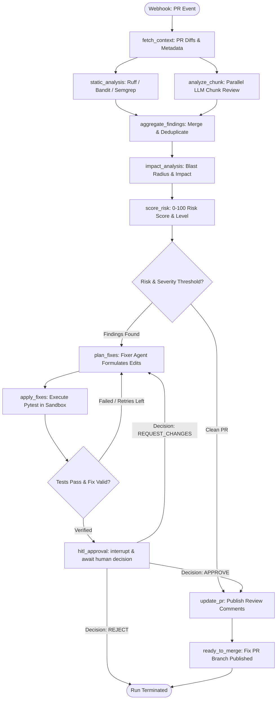

# PR-Review-Assistant

[](https://github.com/AbdelTawwab-Ahmed/PR-Review-Assistant/actions/workflows/ci.yml)
[](https://www.python.org/downloads/release/python-3120/)
[](https://fastapi.tiangolo.com)
[](https://langchain-ai.github.io/langgraph/)
[](https://react.dev)
[](https://opensource.org/licenses/MIT)

> An autonomous, multi-agent AI assistant for GitHub pull requests that performs static analysis, deep LLM code review, blast-radius & risk assessment, automated test validation inside isolated sandboxes, and human-authorized fix commits.

---

## Table of Contents

- [Overview](#overview)
- [Key Features](#key-features)
- [System Architecture](#system-architecture)
  - [Clean Architecture Layers](#clean-architecture-layers)
  - [LangGraph Multi-Agent Workflow](#langgraph-multi-agent-workflow)
- [Human-in-the-Loop (HITL) Review](#human-in-the-loop-hitl-review)
- [Code Execution & Cloud Sandboxes](#code-execution--cloud-sandboxes)
- [Observability & Telemetry](#observability--telemetry)
- [Frontend Review Dashboard](#frontend-review-dashboard)
- [CI/CD & Cloud Deployment](#cicd--cloud-deployment)
- [Getting Started](#getting-started)
  - [Prerequisites](#prerequisites)
  - [Environment Configuration](#environment-configuration)
  - [Running the Backend](#running-the-backend)
  - [Running the Frontend](#running-the-frontend)
  - [Running Tests](#running-tests)
- [Environment Variables Reference](#environment-variables-reference)

---

## Overview

Modern software teams spend significant engineering time reviewing pull requests, checking for lint/security flaws, calculating regression blast radiuses, and writing fixes.

**PR-Review-Assistant** automates this lifecycle by treating pull request review as a coordinated multi-agent workflow:
1. **Listens to GitHub webhooks** (`pull_request.opened`, `synchronize`).
2. **Runs parallel static analyzers** (Ruff, Bandit, Semgrep) and deep semantic LLM analysis across chunked diffs.
3. **Assesses risk and blast radius** (0–100 score + categorized factors).
4. **Formulates and verifies code fixes** inside an isolated execution sandbox (running real `pytest` suites).
5. **Enforces human authorization** via a LangGraph interrupt checkpoint before modifying repository code.
6. **Publishes verified fix branches** to GitHub upon developer approval.

---

## Key Features

- **Multi-Agent Orchestration with LangGraph**: State-driven workflow coordinating reviewer, security, impact, and fixer agents with persistent state checkpointing.
- **Human-in-the-Loop (HITL)**: Workflow pauses via LangGraph `interrupt()` at the approval node. Developers can **Approve**, **Request Changes** (with instructions for the fixer agent to replan), or **Reject**.
- **Dual Sandboxing Engines**:
  - *Local*: Hardened throwaway Docker containers with drop-all capabilities, read-only mounts, and tmpfs workspaces.
  - *Cloud*: Azure Container Apps Dynamic Sessions for on-demand serverless execution environments with automatic local fallback.
- **Enterprise Clean Architecture**: Strict layer boundaries (Domain, Application, Infrastructure, Interfaces) guaranteeing zero framework lock-in.
- **PostgreSQL Persistence**: Review run history, risk factor breakdowns, fix plans, and checkpointer state saved to PostgreSQL (via SQLAlchemy 2.0 Async + `psycopg3` or `AsyncPostgresSaver`).
- **Direct Azure Application Insights Telemetry**: OpenTelemetry tracing and metrics exported directly to Azure Monitor without an external collector daemon.
- **Interactive Review Dashboard**: Built with React 19, TypeScript, Vite, and TanStack Query featuring real-time run inspection, risk score gauges, and a side-by-side diff viewer.

---

## System Architecture

### Clean Architecture Layers

```
PR-Review-Assistant/
├── backend/
│   ├── app/
│   │   ├── domain/               # Enterprise Business Rules (Entities, Value Objects, Enums)
│   │   │   ├── entities/         # PullRequest, ReviewRun, Finding, RiskReport, FixProposal
│   │   │   ├── enums.py          # RunStatus, ApprovalDecision, Severity
│   │   │   └── exceptions.py     # Domain exceptions
│   │   ├── application/          # Use Cases & Orchestration
│   │   │   ├── ports/            # Repository, GitHub, LLM, Sandbox, Cache interfaces
│   │   │   ├── use_cases/        # AnalyzePullRequest, ApproveRun, GetRunStatus, PublishFix
│   │   │   └── workflow/         # LangGraph graph, agent nodes, state definitions
│   │   ├── infrastructure/       # External Service Implementations
│   │   │   ├── analyzers/        # Ruff, Bandit, Semgrep runners
│   │   │   ├── cache/            # Redis & in-memory cache implementations
│   │   │   ├── github/           # GitHub REST API client & webhook signature verifier
│   │   │   ├── llm/              # Azure OpenAI structured output client & TokenTracker
│   │   │   ├── observability/    # Azure Application Insights OpenTelemetry integration
│   │   │   ├── persistence/      # PostgreSQL repositories, models, checkpointer
│   │   │   └── sandbox/          # Docker & Azure Dynamic Sessions sandbox engines
│   │   └── interfaces/           # Presentation & Entrypoints
│   │       └── api/              # FastAPI routers (webhooks, runs, approvals, dev, health)
│   └── tests/                    # Unit, integration, and E2E test suites
└── frontend/                     # React 19 + TypeScript + Vite review dashboard
```

### LangGraph Multi-Agent Workflow



---

## Human-in-the-Loop (HITL) Review

To prevent unauthorized code modifications from being pushed to source repositories, sensitive actions require human approval:

1. When fixes are planned and validated inside the sandbox, execution reaches the `hitl_approval` node.
2. The node invokes LangGraph's `interrupt()` primitive and persists state snapshot in the checkpointer.
3. The review run enters the `AWAITING_APPROVAL` status.
4. The developer inspects the proposed diff and risk breakdown in the web UI.
5. The developer submits an action via `POST /api/runs/{run_id}/approve`:
   - **`approve`**: The workflow resumes via `Command(resume=...)`, commits the verified changes to a new branch (e.g. `pr-fix/pr-42-abc123`), and creates a GitHub pull request.
   - **`request_changes`**: The user supplies text feedback. The graph resumes and routes back to `plan_fixes`, where the fixer agent incorporates the human instructions.
   - **`reject`**: Discards the proposal and marks the run as `REJECTED`.

---

## Code Execution & Cloud Sandboxes

Repository code and tests are treated as **untrusted input** and never executed directly on the host machine.

- **Local Docker Sandbox (`DockerSandbox`)**:
  - Drops all Linux capabilities (`--cap-drop ALL`, `--security-opt no-new-privileges`).
  - Read-only root filesystem and read-only mounted repository source (`/src`).
  - Scratch memory tmpfs for execution (`/workspace`).
  - Network isolation (`--network none`) during test execution; temporary bridge access only for wheel downloads in install mode.
  - Hard CPU, memory (2 GB), PID, and execution timeout limits.
- **Azure Container Apps Dynamic Sessions (`DynamicSessionsSandbox`)**:
  - Provides isolated, on-demand code execution environments in Azure.
  - Automatically tarballs and uploads workspace directories.
  - Zero-configuration fallback: If Azure Dynamic Sessions is not enabled or its endpoint is not configured, the container automatically and transparently falls back to `DockerSandbox`.

---

## Observability & Telemetry

- **Azure Application Insights**: Direct ingestion using `azure-monitor-opentelemetry-exporter` (bypassing the need for an external OTLP daemon).
- **Span Management**: `trace_span` context manager attaches attributes, records unhandled exceptions, and marks `StatusCode.ERROR`.
- **Token & Metric Tracking**: LLM token consumption (prompt tokens, completion tokens, model name, purpose) and review duration histograms are attached to active spans.
- **Offline / Test Safety**: When `APPLICATIONINSIGHTS_CONNECTION_STRING` is unset, the system runs in no-op mode without network requests or test disruptions.

---

## Frontend Review Dashboard

Built with **React 19**, **TypeScript**, **Vite**, and **TanStack Query**:

- **Review Runs Explorer (`/`)**: Search and filter review runs by repository name (`owner/repo`) or PR number.
- **Run Detail View (`/runs/:id`)**:
  - Status header with animated badges (`AWAITING_APPROVAL`, `ANALYZING`, `READY_TO_MERGE`, etc.).
  - Interactive **HITL Action Banner** when awaiting developer authorization.
  - **Risk Assessment Gauge**: Radial gauge displaying overall score (0–100) with color tiering and an itemized risk factor breakdown.
  - **Diff Viewer**: Side-by-side file comparison highlighting original vs. proposed fixes.
  - **Static Analysis Findings**: Filterable findings grid (All, Critical, High, Medium, Low) with recommendations.
  - **Timeline & Notes**: Chronological log of multi-agent decisions and test outputs.

---

## CI/CD & Cloud Deployment

Continuous integration and delivery are automated using **GitHub Actions**:

- **Full-Stack CI (`.github/workflows/ci.yml`)**:
  - **Backend**: Runs on Python 3.12, executes `ruff check .`, `ruff format --check .`, `bandit -r app -q`, and `pytest`.
  - **Frontend**: Runs on Node 20, executes `npm run lint` and `npm run build` (`tsc -b && vite build`).
- **CD to Development (`.github/workflows/cd-dev.yml`)**:
  - Runs on push to `main`.
  - Builds and tags the backend container image (`:dev-latest` and `:${{ github.sha }}`).
  - Pushes to Azure Container Registry (ACR) and deploys to Azure Container Apps (Dev environment).
- **CD to Production (`.github/workflows/cd-prod.yml`)**:
  - Triggered via `workflow_dispatch` with release version tag.
  - Enforces GitHub Environment Protection Rules (requiring human approval before execution).
  - Deploys the container to Azure Container Apps (Production environment).

---

## Getting Started

### Prerequisites

- **Python**: `>= 3.12`
- **Node.js**: `>= 20.0` and `npm`
- **Docker**: For local sandboxed code execution
- **Redis** & **PostgreSQL**: (or set `CACHE_BACKEND=memory` and `CHECKPOINTER_BACKEND=memory` for zero-dependency local development)

### Environment Configuration

Copy the example environment file:

```bash
cp .env.example .env
```

Populate the required credentials in `.env` (Azure OpenAI, GitHub Token, Application Insights, Database URL).

### Running the Backend

```bash
cd backend
python -m venv .venv
source .venv/bin/activate  # On Windows: .venv\Scripts\activate
pip install -e ".[dev]"

# Start the FastAPI dev server
uvicorn app.main:app --reload --port 8000
```

The API docs are available at `http://localhost:8000/docs`.

### Running the Frontend

```bash
cd frontend
npm ci --legacy-peer-deps
npm run dev
```

Open `http://localhost:5173` to access the Review Dashboard.

### Running Tests

```bash
# Backend test suite
cd backend
pytest

# Code style and security checks
ruff check .
ruff format --check .
bandit -r app -q

# Frontend checks
cd ../frontend
npm run lint
npm run build
```

---

## Environment Variables Reference

| Variable | Description | Default |
|---|---|---|
| `ENVIRONMENT` | Environment name (`development`, `production`, `test`) | `development` |
| `LOG_LEVEL` | Logging level (`DEBUG`, `INFO`, `WARNING`, `ERROR`) | `INFO` |
| `DATABASE_URL` | PostgreSQL connection string (`postgresql+psycopg://...`) | `""` |
| `CHECKPOINTER_BACKEND` | Checkpoint storage (`postgres` or `memory`) | `memory` |
| `CACHE_BACKEND` | Cache backend (`redis` or `memory`) | `memory` |
| `REDIS_URL` | Redis instance URL | `redis://localhost:6379/0` |
| `GITHUB_TOKEN` | GitHub Personal Access Token or App Token | `""` |
| `GITHUB_WEBHOOK_SECRET` | Secret for verifying GitHub webhook HMAC signatures | `""` |
| `AZURE_OPENAI_ENDPOINT` | Azure OpenAI instance URL | `""` |
| `AZURE_OPENAI_API_KEY` | Azure OpenAI API Key | `""` |
| `AZURE_OPENAI_DEPLOYMENT_STRONG` | Strong model deployment name (e.g. `gpt-4o`) | `""` |
| `AZURE_OPENAI_DEPLOYMENT_FAST` | Fast model deployment name (e.g. `gpt-4o-mini`) | `""` |
| `SANDBOX_ENABLED` | Enable Docker / Cloud sandbox execution | `false` |
| `SANDBOX_BACKEND` | Sandbox provider (`docker` or `dynamic_sessions`) | `docker` |
| `APPLICATIONINSIGHTS_CONNECTION_STRING` | Azure Application Insights connection string | `""` |
| `TELEMETRY_ENABLED` | Toggle OpenTelemetry / Application Insights export | `true` |

---

## License

This project is licensed under the MIT License - see the [LICENSE](LICENSE) file for details.
